<h1 align="center">North American Bear Killings</h1>
<p align="center"><b>Data preprocessing and visualization midterm · MEXE Electives 2</b></p>
<p align="center">
  
  
  
  
</p>

---

## Contents

1. [Group information](#1-group-information)
2. [Project overview](#2-project-overview)
3. [Flowchart](#3-flowchart)
4. [Preprocessing summary](#4-preprocessing-summary)
5. [Visualizations](#5-visualizations)
6. [Key insights](#6-key-insights)
7. [How to run](#7-how-to-run)
8. [Open dashboard](https://johnking-solis.github.io/Midterms-2/Aguila_Solis_BearKillings/)

---

## 1. Group information

| | |
|---|---|
| **Group name** | Aguila & Solis |
| **Members** |  Aguila, Carl Michael P.,  Solis, John King Louies |
| **Assigned theme**  | Animals  |
| **Topic** | North American bear killings: recorded fatal bear attacks |

## 2. Project overview

| | |
|---|---|
| **Dataset title** | North American bear killings (`north_america_bear_killings.csv`) |
| **Source (URL or reference)** | (https://www.kaggle.com/datasets/vainero/north-america-bear-killings)|
| **License / attribution** | Unknown. Confirm the license before reuse. |
| **Objective** |This project aims to clean and prepare 166 recorded bear-killing incidents in North America and understand how different factors, such as date, location, bear type, incident type, and other recorded details, are related to the reported incidents. It also aims to check missing values, duplicate rows, data types, and possible outliers to ensure the dataset is properly prepared for analysis. Through data preprocessing and  visualizations, we want to identify patterns in when, where, and how these incidents were recorded, without treating the number of recorded incidents as a measure of actual risk. |

**Dataset at a glance:** 166 rows · 14 columns · years 1901 to 2018 · 2 settings (wild, captive) · 3 bear types (brown, black, polar)

## 3. Flowchart

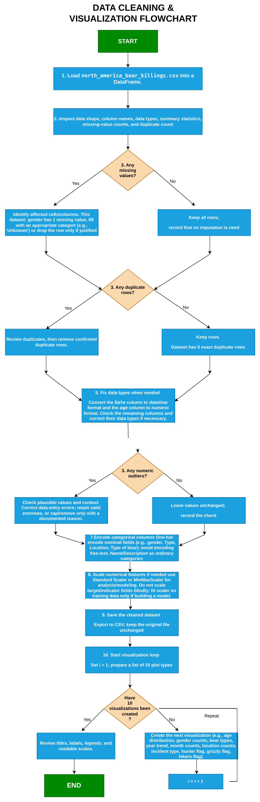

The flowchart is our original draw.io file, exported as a single image. The PDF is in the same folder (`flowchart/BearKillings_Flowchart_Aguila_Solis.pdf`).

**Decisions in our flowchart and what we chose**

| Decision (flowchart step) | YES branch | NO branch | What we chose |
|---|---|---|---|
| **Step 3:** Any missing values? | Identify affected cells; fill with an appropriate category, or drop only if justified | Keep all rows and record that no imputation is needed | **YES.** `gender` has 1 missing value. We filled it with `Unknown` and did not drop the row. |
| **Step 3:** Any duplicate rows? | Review, then remove confirmed duplicates | Keep rows | **NO.** The dataset has 0 exact duplicate rows, so all 166 rows were kept. |
| **Step 3:** Any numeric outliers? | Check plausible values; retain valid extremes; cap or remove only with a documented reason | Leave values unchanged and record the check | **NO.** The IQR rule found 0 age outliers (fences at −23 and 97). A flag column was still added for review and no rows were removed. |

**Changes we made.** The code differs from the flowchart in four places. Each change is listed below with the reason.

1. **Feature engineering was added (not in the flowchart).** `incident_month`, `incident_year`, `incident_decade` and `incident_season` are derived from `Date`. The temporal charts (2, 3, 8) need them.
2. **Validation was added (not in the flowchart).** The saved CSV is reloaded and its shape, duplicates, missing values and types are checked against the cleaned data.
3. **`Location` was not one-hot encoded.** The flowchart lists it as a nominal field. It has 132 distinct values, so one-hot encoding would add 132 columns to the model-ready table. `Location` stays as text in the cleaned file and is left out of the model-ready table. `Name`, `Description` and `Date` are also left out, as the flowchart asks for free text.
4. **Four extra plots were added** (charts 11 to 14). The flowchart's loop gives example plots, but the rubric also requires a correlation heatmap, a missingness plot, a pairplot or second distribution, and an advanced plot. We could not meet those with the ten plots alone. Location counts are also not among our ten charts.

## 4. Preprocessing summary

The steps follow the flowchart order. The notebook labels each code block with the matching flowchart step.

| Flowchart step | What we did | Result |
|---|---|---|
| **1.** Load the CSV | Read `north_america_bear_killings.csv` into a DataFrame. Kept an untouched copy for comparison. | 166 rows × 14 columns |
| **2.** Inspect | Checked shape, column names, dtypes, `describe()`, missing counts and duplicate count. | `age` stored as text; its header has a leading space |
| **3.** Missing values | Trimmed whitespace and non-breaking spaces; blank text to NA; `gender` NA → `Unknown`. | 1 value filled |
| **3.** Duplicate rows | Checked for exact duplicates. | 0 found, none removed |
| **5.** Fix data types | Stripped column names; `age` → numeric (Int64); `Date` → datetime; `Month` and `Year` re-derived from `Date`. | 5 non-numeric ages stay missing |
| **3.** Numeric outliers | IQR rule on `age`. Flagged for review, not deleted. | 0 flagged |
| *Added* Feature engineering | `incident_month`, `incident_year`, `incident_decade`, `incident_season`. | 4 new columns |
| **7.** Encode categoricals | Model-ready copy: one-hot `gender`, `Type`, `Type of bear`. `Location`, `Name`, `Description`, `Date` not encoded. | 166 × 20 |
| **8.** Scale numerical features | `StandardScaler` on `age` into `age_scaled`, in the model-ready copy only. The original `age` is kept. | 161 values scaled |
| **9.** Save the cleaned dataset | `cleaned_north_america_bear_killings.csv` (readable) and `model_ready_bear_killings.csv` (encoded). The original CSV is unchanged. | 59 KB and 13 KB |
| *Added* Validate | Reloaded the saved file; compared shape, duplicates, missing values and dtypes. | 166 × 19, matches |
| **10.** Visualization loop | Ten charts from the cleaned data, each with title, axis labels and caption. | See section 5 |
| *Extra* | Missingness, correlation heatmap, KDE and pairplot, PCA. | Four more charts |

## 5. Visualizations

**14 plots in total** (the rubric asks for at least 10). The first ten come from the flowchart's visualization loop (step 10). The last four are extra plots added for rubric coverage.

### Gallery

<table>
<tr>
<td align="center">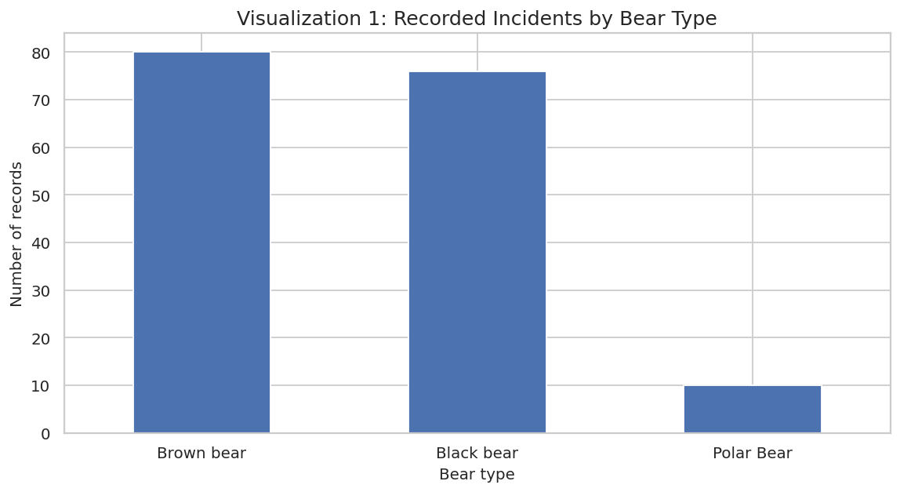<br><b>1.</b> Records by bear type</td>
<td align="center">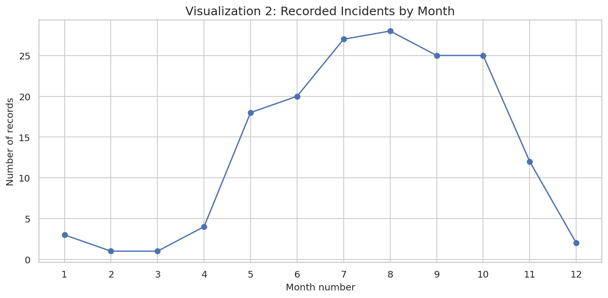<br><b>2.</b> Incidents by month</td>
<td align="center">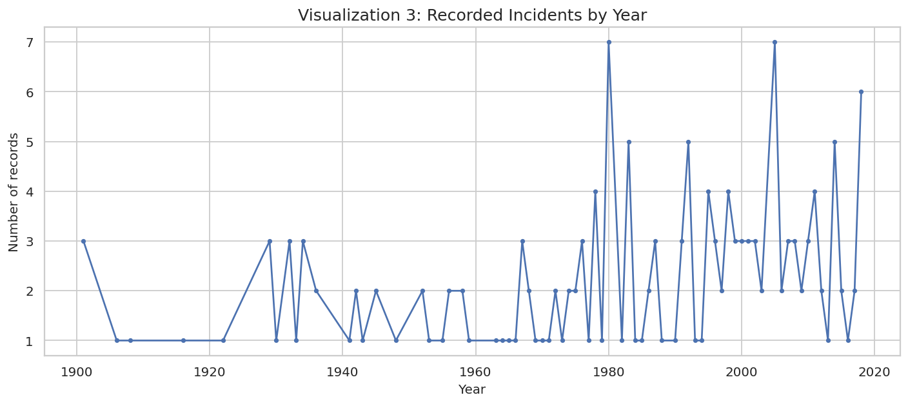<br><b>3.</b> Incidents by year</td>
</tr>
<tr>
<td align="center">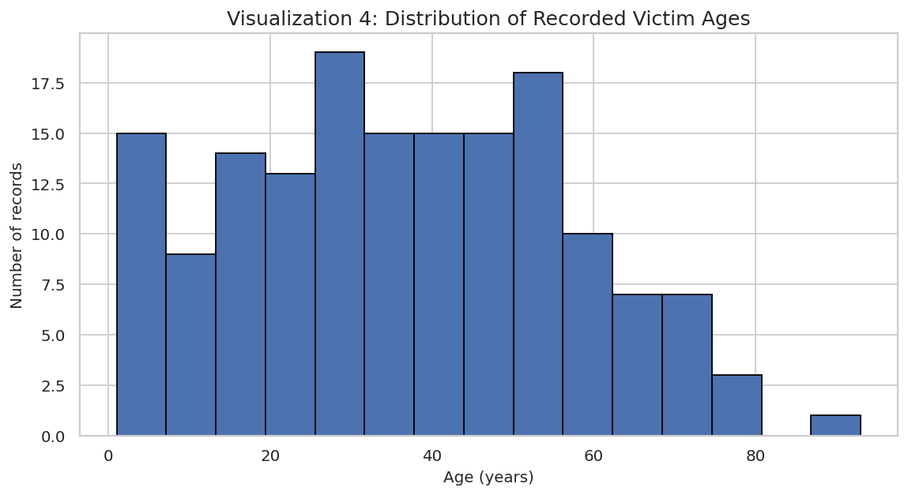<br><b>4.</b> Victim age histogram</td>
<td align="center">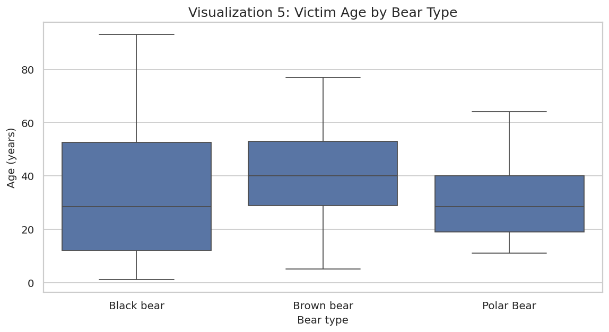<br><b>5.</b> Age by bear type (box)</td>
<td align="center">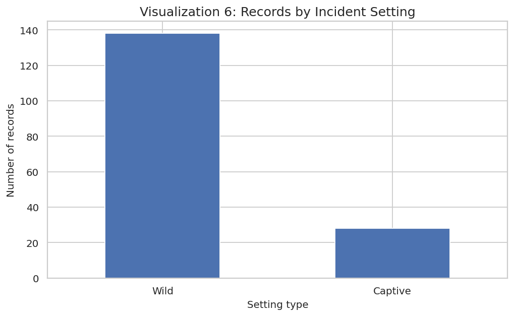<br><b>6.</b> Wild vs captive</td>
</tr>
<tr>
<td align="center">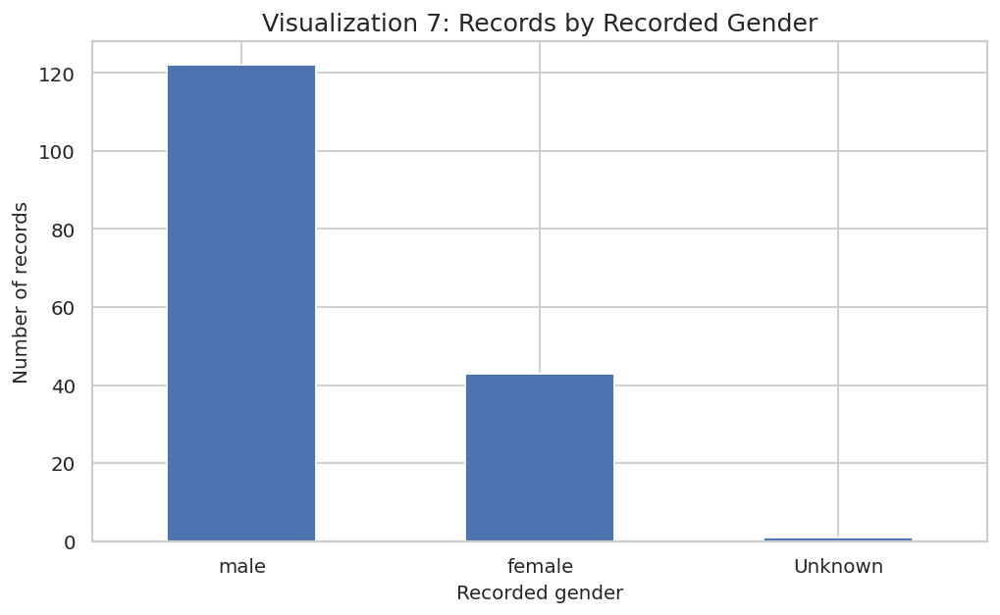<br><b>7.</b> Records by recorded gender</td>
<td align="center">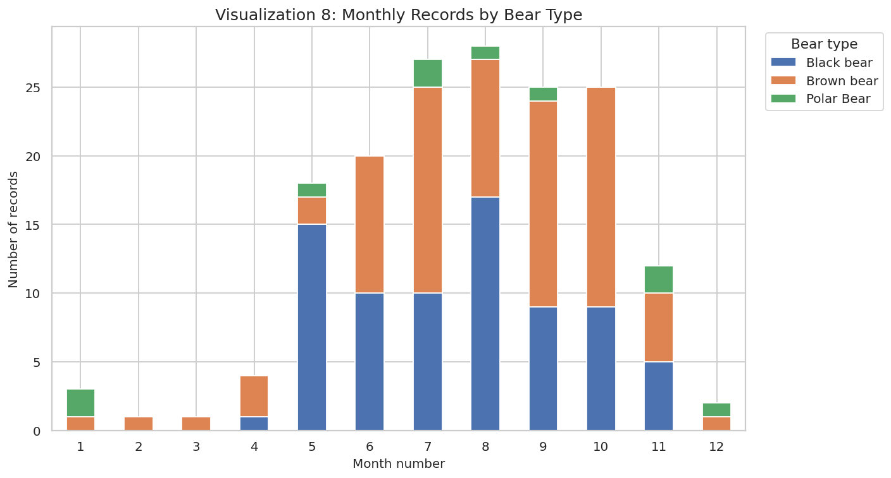<br><b>8.</b> Monthly records by bear type</td>
<td align="center">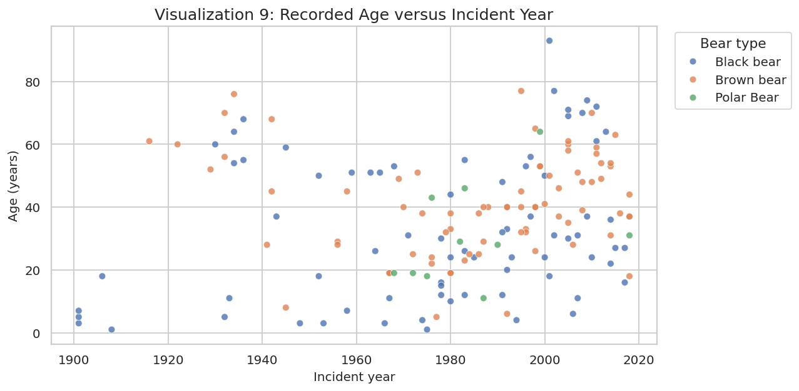<br><b>9.</b> Age vs incident year</td>
</tr>
<tr>
<td align="center">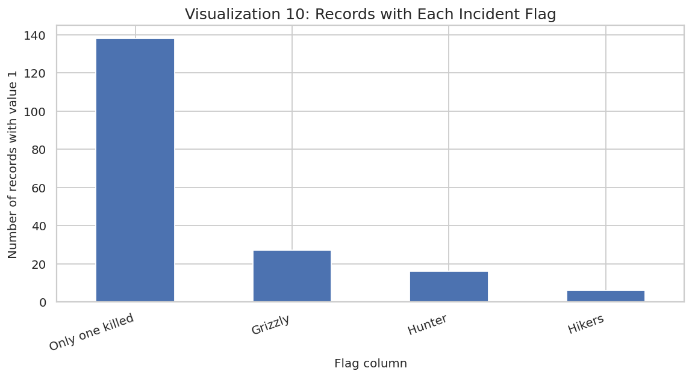<br><b>10.</b> Incident flags</td>
<td align="center">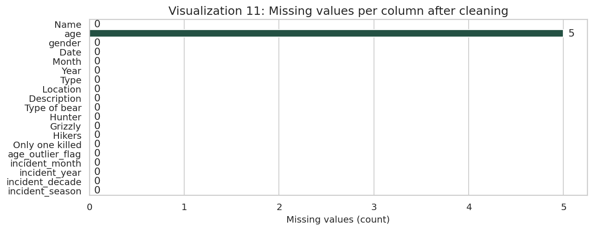<br><b>11.</b> Missingness after cleaning</td>
<td align="center">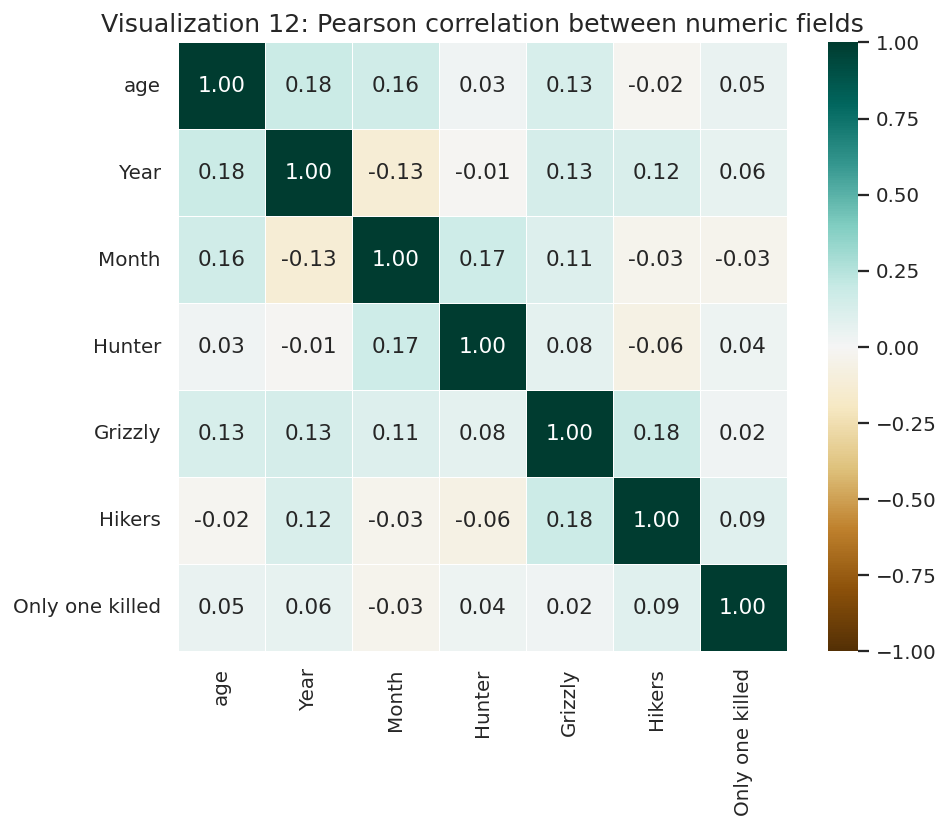<br><b>12.</b> Correlation heatmap</td>
</tr>
<tr>
<td align="center">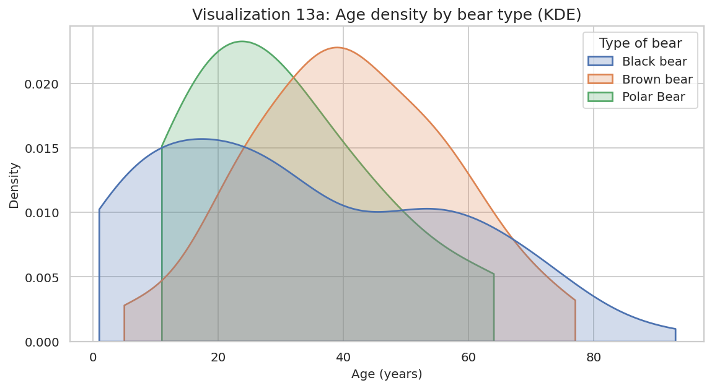<br><b>13a.</b> Age density (KDE) by bear type</td>
<td align="center">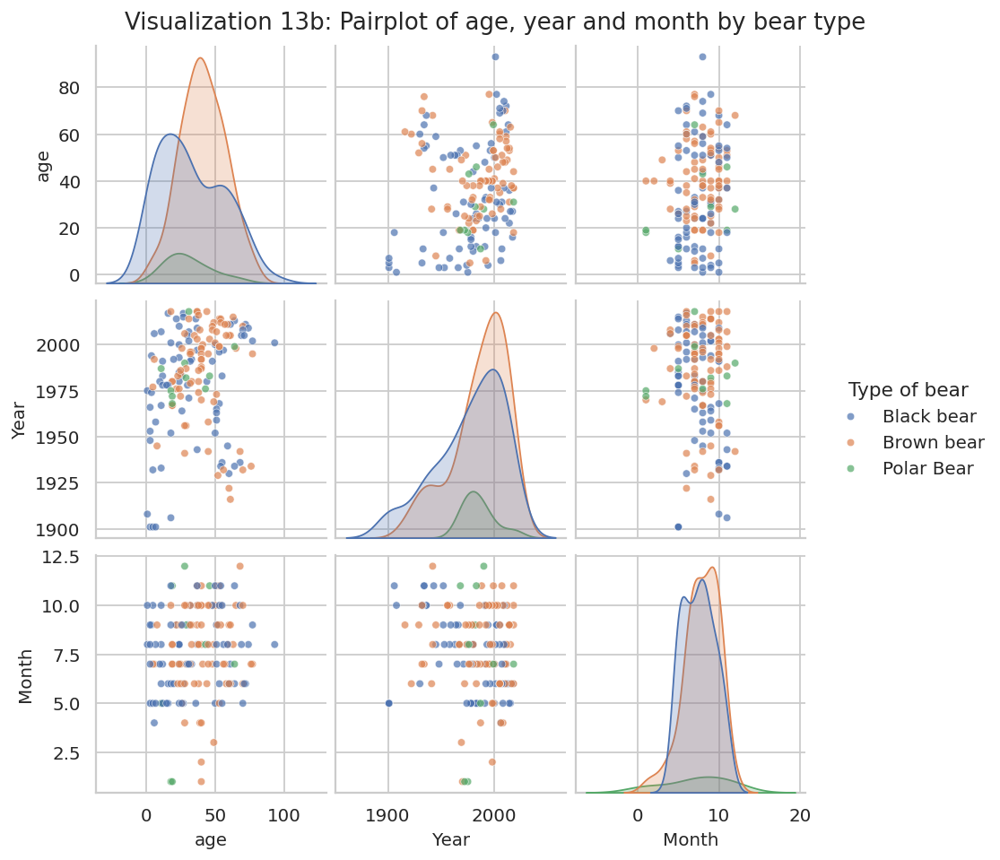<br><b>13b.</b> Pairplot: age, year, month</td>
<td align="center">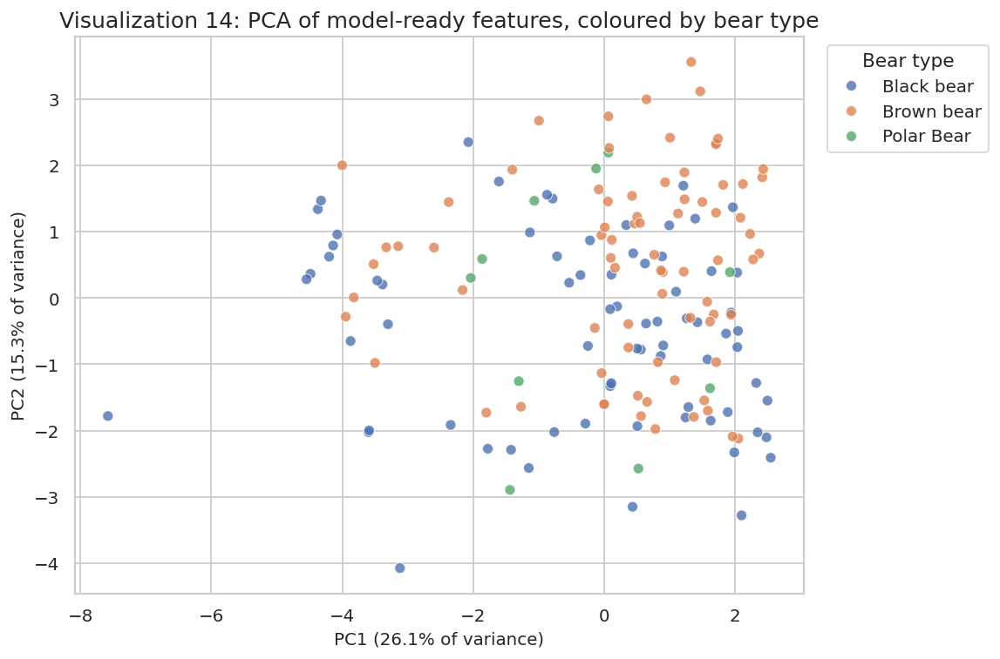<br><b>14.</b> PCA of model-ready features</td>
</tr>
</table>

### Plot descriptions and insights

| # | Plot | Type (rubric) | What it shows | Insight |
|---|---|---|---|---|
| 1 | Records by bear type | Categorical | Brown 80, black 76, polar 10 | Brown and black bears make up 94% of records |
| 2 | Incidents by month | Temporal | Records per calendar month | Activity peaks July to September |
| 3 | Incidents by year | Temporal | Records per year, stacked by bear | Counts are sparse before 1970; coverage likely improved after |
| 4 | Victim age histogram | Distribution | Ages in 5-year bins | 99 of 161 recorded ages (62%) fall between 20 and 59 |
| 5 | Age by bear type | Box plot | Median, middle half, range | Brown bear median is 40; black and polar are 28.5 |
| 6 | Wild vs captive | Categorical | Setting counts | 138 wild, 28 captive |
| 7 | Records by gender | Categorical | Male, female, unknown | 122 male, 43 female, 1 unknown. Counts only, no exposure data |
| 8 | Monthly by bear type | Temporal | Monthly bars, stacked | Black bear records peak in May and August; brown bear records peak in July, September and October |
| 9 | Age vs year | Multivariate | One dot per record | No clear trend in age over time |
| 10 | Incident flags | Categorical | Records with each flag = 1 | "Only one killed" = 138; "Grizzly" = 27; "Hunter" = 16; "Hikers" = 6 |
| 11 | Missingness | Missingness | Missing values per column | Only `age` has gaps (5 records) |
| 12 | Correlation heatmap | Correlation | Pearson r, numeric fields | Correlations are weak (all |r| under 0.2). No strong linear links |
| 13a | Age KDE by bear type | Distribution | Smoothed age density | Brown bear victims skew older than black bear victims |
| 13b | Pairplot | Multivariate | Age, year, month by bear | Confirms the weak links shown in the heatmap |
| 14 | PCA | Advanced | 2D projection of features | Bear types overlap heavily; no clean clusters |

## 6. Key insights

1. **Most records are wild incidents.** 138 of 166 (83%) records are labelled wild, and 28 are captive.
2. **Two bear types account for nearly all records.** Brown bears (80) and black bears (76) are 94% of records. Polar bears have 10. Brown bear victims have the highest median recorded age (40).
3. **Records cluster in summer and early autumn.** June to October holds most records, and August has the most (28). Winter has only 6.
4. **Recording is uneven over time.** Counts rise sharply after 1970 (about 18 to 28 per decade), which likely reflects better documentation rather than more incidents.
5. **The data is clean but limited.** No duplicates, one missing gender, and five ages that are not numbers. It also has no source link or data dictionary, so counts describe the file only. They cannot show the risk of an attack.

## 7. How to run

**Option A: Google Colab (recommended)**
1. Open `notebooks/BearKillings_Midterm_Aguila_Solis.ipynb` in Colab (*File → Upload notebook*, or *GitHub → Open notebook*).
2. Run the first cell. When asked, upload `data/north_america_bear_killings.csv`.
3. *Runtime → Run all.*

**Option B: Local Jupyter**
```bash
pip install -r requirements.txt
cp data/north_america_bear_killings.csv notebooks/
cd notebooks
jupyter notebook BearKillings_Midterm_Aguila_Solis.ipynb
```

The notebook looks for the CSV in the working folder first, so copy it there (Option B) or upload it when prompted (Option A).

**Interactive dashboard:** `index.html` is a single file with the data built in. Open it in any browser. It needs an internet connection to load Chart.js and fonts.

---

<p align="center"><sub>Built from the MEXE Electives 2 midterm. Counts describe recorded cases only and should not be read as population-level risk.</sub></p>
